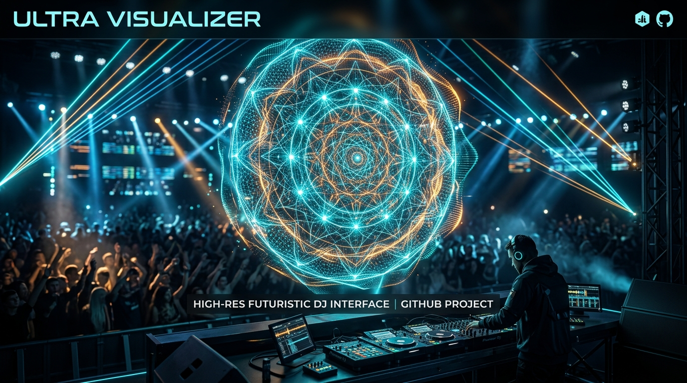
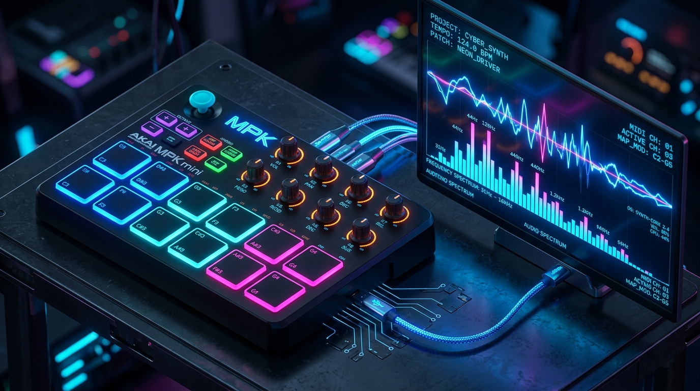

<p align="center">
  
</p>

<h1 align="center">⚡ DJ Performance Engine</h1>

<p align="center">
  <strong>Hardware-Accelerated, Audio-Reactive Audiovisual Engine for Live Concerts & OBS Studio</strong>
</p>

<p align="center">
  <a href="https://github.com/alanantony17/DJ-Performance-Engine"></a>
  
  
  
  
  
</p>

---

## 🌟 Overview

**DJ Performance Engine** is a high-performance, single-page audiovisual synthesizer and stage visualizer engineered specifically for live DJ performances, festival streams, and club visual sets. 

Loaded as an **OBS Studio Browser Source** (1920×1080 @ 60 FPS) or run standalone in any modern Chromium browser, the engine bridges tactile music hardware (**AKAI MPK Mini 3**) with GPU-accelerated WebGL shader mechanics and real-time kick-transient detection.

Whether performing live on stage or broadcasting to Twitch/YouTube, the engine responds instantaneously to your mixer's audio transients and MIDI triggers with zero discernible latency.

---

## 🚀 Key Highlights & Architecture

```
                       ┌─────────────────────────┐
                       │   Audio / Mixer Stream  │
                       │   (VB-Audio / Mic / In) │
                       └────────────┬────────────┘
                                    │ (Native Web Audio API)
                                    ▼
┌────────────────────────┐    ┌─────────────────────────┐
│ AKAI MPK Mini 3 / MIDI ├────► Transient & FFT Analysis │
│  (Native Web MIDI API) │    │  4-on-Floor Drop Engine │
└────────────────────────┘    └────────────┬────────────┘
                                           │
                                    ┌──────┴──────┐
                                    ▼             ▼
       ┌───────────────────────────────┐   ┌───────────────────────────────┐
       │   Layer 1: Three.js WebGL     │   │   Layer 2: 2D Strobe Engine   │
       │   128x128 3D Mesh Displacement│   │   Spatial Lasers / Blinders   │
       │   Dynamic Camera & Ripples    │   │   Accelerating Buildup Ramps  │
       └───────────────┬───────────────┘   └───────────────┬───────────────┘
                       │                                   │
                       └─────────────────┬─────────────────┘
                                         ▼
                       ┌───────────────────────────────────┐
                       │ Fullscreen Composite (1080p 60FPS)│
                       │     OBS Studio Browser Source     │
                       └───────────────────────────────────┘
```

### 1. Dual-Canvas Compositing
* **Bottom Canvas (`#three-canvas`)**: High-performance Three.js WebGL renderer executing a $128 \times 128$ subdivided vertex displacement mesh. Renders liquid wave physics, radial sacred mandala geometry, chromatic UV shear, and organic displacement ripples.
* **Top Canvas (`#strobe-canvas`)**: 2D spatial lighting, accelerating blinder sweeps, and concert strobes layered seamlessly via `mix-blend-mode: screen`.

### 2. Intelligent Audio Transient Engine
* **Sub-Bass & Kick Isolation**: FFT bin filtering ($35\text{ Hz} - 300\text{ Hz}$) with calibrated exponential falloff and transient onset cooldowns to ensure punchy single-hit impulses.
* **4-on-the-Floor Cadence Tracker**: Automagically detects house and techno kick cadences. Adapts between mellow, glassy verse dynamics and towering 3D wave canyons during drops.
* **Dynamic Contrast Power Gamma**: Non-linear power expansion ($2.4\gamma$) squashes low-energy background rumble while giving drops up to $+28\%$ scale recoil and camera kick impulse.

### 3. Dynamic Hot-Swappable Asset Pipeline
* Hot-reload high-resolution visuals on the fly by simply **dragging and dropping** any JPG or PNG into the window.
* Strict VRAM resource disposal (`oldTexture.dispose()`) ensures stable 60 FPS operation across 4+ hour marathon sets.
* Automated local discovery: Discovers high-resolution album art, sacred mandalas, and generative visuals located in `/assets/` dynamically via `serve.py`.

---

## 🎛️ Hardware Controller Mapping (AKAI MPK Mini 3)

The engine provides out-of-the-box hardware integration with the **AKAI MPK Mini 3** (Program 1) via native Web MIDI:

<p align="center">
  
</p>

### 🎚️ Knobs & Joystick Controls

| Control | MIDI CC / Type | Function | Range / Details |
| :--- | :--- | :--- | :--- |
| **Joystick X-Axis** | Pitch Bend | 3D Camera Horizontal Pan & Strobe Beam | Fluid horizontal sweep across stage |
| **Joystick Y-Axis** | Modulation (CC 1) | 3D Camera Zoom / Aperture Distance | Push forward to plunge into geometry |
| **Knob 1** | CC 70 | Ripple Flow Rate & Strobe LFO | 2 Hz to 50 Hz fluid wave frequency |
| **Knob 2** | CC 71 | Master Visual Hue Shift | Chromatic color palette morphing |
| **Knob 3** | CC 72 | Wave Spread / Harmonic Wavelength | Controls spatial wave distribution |
| **Knob 4** | CC 73 | Wave Depth / Audio Sensitivity | Multiplier for kick audio displacement |
| **Knob 5** | CC 74 | 4-on-Floor Drop Cadence Threshold | Adjusts auto-drop trigger sensitivity |

---

### 🎹 Dual-Bank 16-Pad Performance Matrix

#### 🔴 BANK A: "Hotcue Keys" (Live Performance & Action Hits)

| Pad | Note / CC | Action | Description |
| :---: | :---: | :--- | :--- |
| **Pad 1** | Note 36 / CC 20 | **4-Bar Buildup Trigger** | Quantized 4-bar accelerating riser into drop climax |
| **Pad 2** | Note 37 / CC 21 | **8-Bar Buildup Trigger** | Extended 8-bar concert riser with intensifying strobes |
| **Pad 3** | Note 38 / CC 22 | **Cycle Artwork Asset** | Switches instantly to the next high-res texture in `/assets/` |
| **Pad 4** | Note 39 / CC 23 | **🚨 DROP SLAM** | **Master Blackout Panic Key**: Instant cut across all visuals |
| **Pad 5** | Note 40 / CC 24 | **Cycle 3D Motion Preset** | Steps through the 4 liquid wave displacement modes |
| **Pad 6** | Note 41 / CC 25 | **Toggle Auto-Hue Flow** | Toggles seamless chromatic color cycling |
| **Pad 7** | Note 42 / CC 26 | **Temporal Beat Repeat** | Quantized frame stutter & temporal freeze (1/4, 1/8, 1/16, 1/32) |
| **Pad 8** | Note 43 / CC 27 | **Negative X-Ray Flash** | High-contrast inverted color flash toggle |

#### 🔵 BANK B: Arming & Utility Configuration Matrix

| Pad | Note / CC | Action | Description |
| :---: | :---: | :--- | :--- |
| **Pad B1** | Note 44 / CC 28 | **Cycle Beat Repeat Rate** | Cycles temporal freeze subdivision: $1/4 \rightarrow 1/8 \rightarrow 1/16 \rightarrow 1/32$ |
| **Pad B2** | Note 45 / CC 29 | **Toggle Framing Mode** | Switches between **World-Field** (16:9) and **Radial Portal** totem mask |
| **Pad B3** | Note 46 / CC 30 | **Toggle Drop Mode** | Overrides cadence tracker to force High-Energy Drop dynamics |
| **Pad B4** | Note 47 / CC 31 | **🚨 DROP SLAM (Panic)** | Instant blackout & slicer reset directly accessible from Bank B |
| **Pad B5** | Note 48 / CC 32 | **Arm Riser 1: Kinetic Blitz** | High-frequency whiteout strobe with icy-blue chromatic wash |
| **Pad B6** | Note 49 / CC 33 | **Arm Riser 2: Dark Implosion** | Singularity vortex suction, cobalt chill, and total drop silence |
| **Pad B7** | Note 50 / CC 34 | **Arm Riser 3: Chromatic Tear** | RGB split channel separation, acid cyan/magenta scanlines |
| **Pad B8** | Note 51 / CC 35 | **Arm Riser 4: Solar Bloom** | Molten golden corona flare erupting across the canvas |

---

## ⌨️ Headless & Keyboard Fallback Controls

No MIDI controller connected? You can test and control every function using keyboard hotkeys:

| Key | Function | Key | Function |
| :--- | :--- | :--- | :--- |
| <kbd>1</kbd> | Trigger 4-Bar Buildup | <kbd>D</kbd> | Toggle Diagnostic HUD Telemetry |
| <kbd>2</kbd> | Trigger 8-Bar Buildup | <kbd>V</kbd> | Cycle 3D Motion Presets |
| <kbd>3</kbd> | Cycle Artwork Asset | <kbd>B</kbd> | Force Drop / Chorus Dynamics |
| <kbd>4</kbd> | **DROP SLAM Blackout** | <kbd>M</kbd> | Toggle Framing Mode (Portal / World) |
| <kbd>5</kbd> | Cycle Motion Mode | <kbd>N</kbd> | Toggle Negative X-Ray Color |
| <kbd>6</kbd> | Toggle Auto-Hue Flow | <kbd>P</kbd> | Toggle Slicer Grid |
| <kbd>7</kbd> | Temporal Beat Repeat Hold | <kbd>C</kbd> | Reset Camera Pan & Zoom |
| <kbd>8</kbd> | Negative Inversion Flash | <kbd>[</kbd> / <kbd>]</kbd> | Adjust BPM Down / Up |
| <kbd>\</kbd> | Tap Tempo | <kbd>T</kbd> / <kbd>G</kbd> | Drop Cadence Threshold Adjust |

---

## 🌀 3D Motion Modes & Concert Risers

### 🌊 3D Motion Presets
1. **Beat-Synced Liquid Ripple**: Center kick waves outward, snare ripples inward, melodies undulate in tempo.
2. **Kinetic Kick Shockwave**: High-amplitude seismic wave rings bursting radially from the center on heavy kicks.
3. **Melody Harmonic Waves**: Fluid multi-frequency standing waves tuned to vocal ranges and lead synths.
4. **Snare & Kick Interlock**: Opposing dual-axis wave fronts colliding across the geometry in counterpoint.

### 🌪️ Concert Riser Archetypes
* **Kinetic Blitz** *(Gold / Blue)*: Accelerating high-frequency strobe + blinding whiteout wash into the drop.
* **Dark Implosion** *(Cobalt / Obsidian)*: Drains color, pulls geometry into an event-horizon vortex, and cuts all sound into total pre-drop vacuum silence.
* **Chromatic Tear** *(Cyan / Magenta)*: Splits red, green, and blue color channels with glitch scanlines.
* **Solar Bloom** *(Molten Amber / White)*: Luminescent solar flare erupting across the 1080p canvas with fluid wave boiling.

---

## 🖥️ Setup & OBS Studio Integration

### 1. Run the Local Development Server
The engine includes a Python HTTP server with CORS headers, MIME typing, and an automatic dynamic asset discovery endpoint (`/api/assets`):

```bash
# Clone the repository
git clone https://github.com/alanantony17/DJ-Performance-Engine.git
cd DJ-Performance-Engine

# Launch server (default port 8000)
python3 serve.py
```
*(On Windows, you can alternatively double-click `push-to-github.bat` or `serve.py`)*.

Visit `http://localhost:8000` in Google Chrome, Brave, or Microsoft Edge.

---

### 2. Configure Audio Routing (VB-Audio Virtual Cable)
To feed live music directly from your DJ software (Rekordbox, Serato, Traktor, VirtualDJ, Ableton) into the visualizer:
1. Install **[VB-Audio Virtual Cable](https://vb-audio.com/Cable/)** (free virtual audio driver).
2. Set your DJ software's Master Output or Booth Monitor to **CABLE Input**.
3. In Chrome or OBS, select **CABLE Output** as the audio input device.

---

### 3. Add to OBS Studio as a Browser Source
1. Open OBS Studio and create a new **Browser Source** in your Scene.
2. Configure the source properties:
   * **URL**: `http://localhost:8000`
   * **Width**: `1920`
   * **Height**: `1080`
   * **FPS**: `60`
   * Check **"Control audio via OBS"** (if routing sound internally).
   * Check **"Reroute audio to OBS"** / **"Shutdown source when not visible"** as desired.
3. Click **OK**. Tap any mapped MIDI Pad or press <kbd>Space</kbd> on the interact window to engage the engine!

---

## 🤝 Contributing & Collaborating

Contributions, shader experiments, MIDI controller mappings, and performance optimizations are warmly welcomed!

### Collaborative Workflow (Fork & Pull Request)

1. **Fork this repository** to your personal GitHub account.
2. **Clone your fork locally**:
   ```bash
   git clone https://github.com/<your-username>/DJ-Performance-Engine.git
   cd DJ-Performance-Engine
   ```
3. **Add the upstream repository** to keep your local branch in sync:
   ```bash
   git remote add upstream https://github.com/alanantony17/DJ-Performance-Engine.git
   ```
4. **Create a dedicated feature branch**:
   ```bash
   git checkout -b feature/my-new-shader
   ```
5. **Commit your modifications** with clear, descriptive messages:
   ```bash
   git commit -m "feat(shaders): add chromatic aberration post-processing pass"
   ```
6. **Push to your fork**:
   ```bash
   git push -u origin feature/my-new-shader
   ```
7. **Submit a Pull Request** against `alanantony17/DJ-Performance-Engine` on the `main` branch.

### Syncing with Upstream
To keep your fork up to date with new commits from the original repository:
```bash
git fetch upstream
git checkout main
git merge upstream/main
```

---

## 👏 Credits & Author Acknowledgments

* **Original Creator & Lead Architect**:  
  **Alan Antony** ([@alanantony17](https://github.com/alanantony17))  
  *Original Repository: [alanantony17/DJ-Performance-Engine](https://github.com/alanantony17/DJ-Performance-Engine)*

* **Community Contributors & Enhancements**:  
  **Aniket Chatterjee** ([@iamaniketc](https://github.com/iamaniketc))  
  *Fork Repository: [iamaniketc/DJ-Performance-Engine](https://github.com/iamaniketc/DJ-Performance-Engine)*

Special thanks to the **Three.js** and **Web Audio API** open-source communities for enabling high-performance real-time graphics inside the browser.

---

<p align="center">
  <sub>Built with ❤️ for DJs, VJs, and live stream performers worldwide.</sub>
</p>
